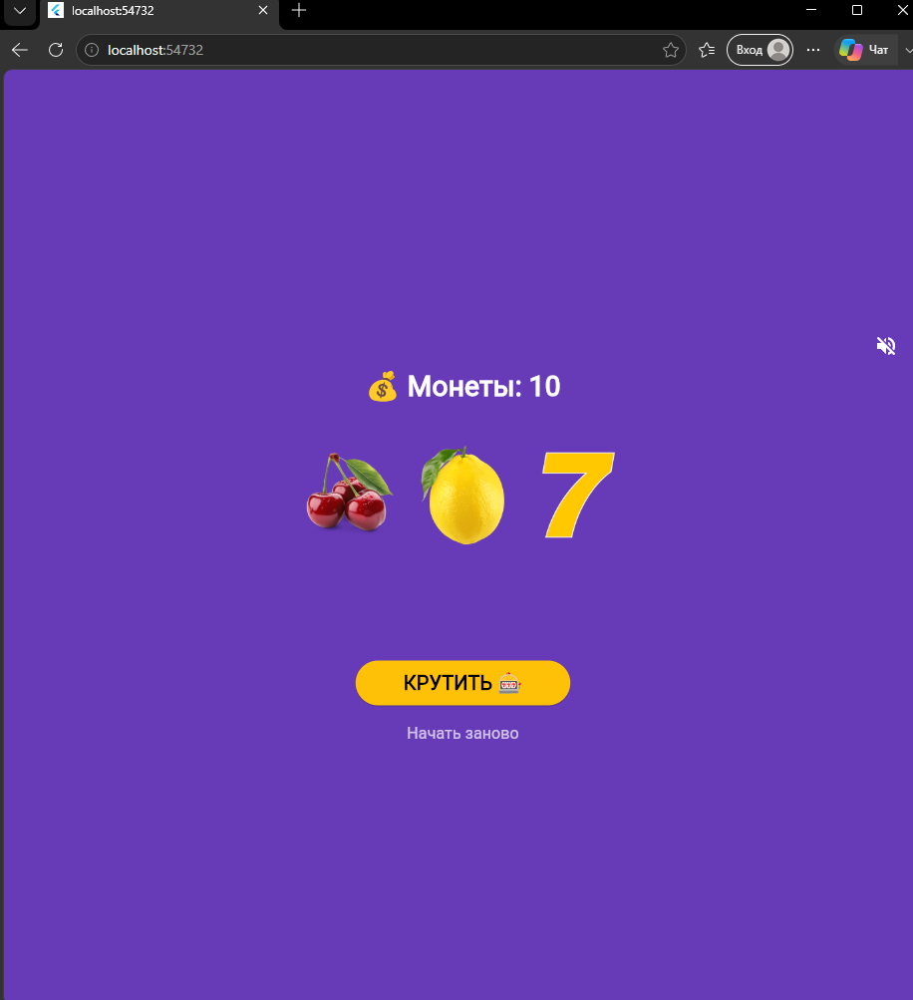
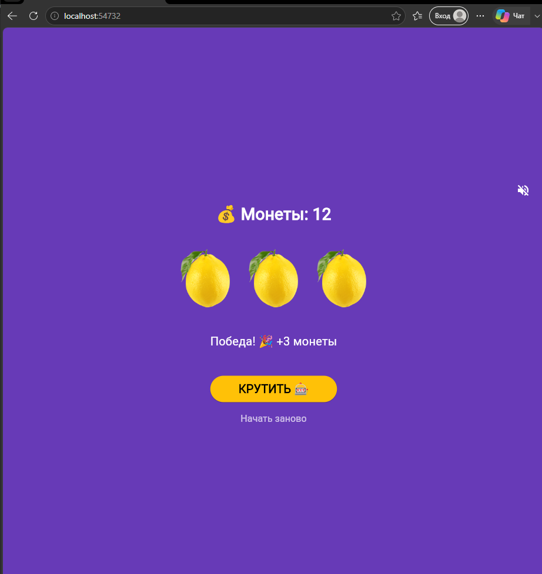

# Лабораторная работа №10. Слот-машина

Автор: Резник Анжелика. Группа: ИСП-242. Дата: 11.11.2026.

| Главный экран | Результат | Монеты закончились |
| --- | --- | --- |
|  |  |  |

- Запуск: `flutter pub get`, затем `flutter run -d edge` или `flutter run -d ID_устройства`.
- Звук включается отдельной кнопкой; до её нажатия приложение молчит.
- Сборка Android: `flutter build apk --release`.
- Готовый файл: `build/app/outputs/flutter-apk/app-release.apk`.
- APK: [Скачать app-release.apk](https://github.com/Anzhela2014/lab10mob/releases)
- Проверенные Flutter/Dart: Flutter 3.47.9 • Dart 3.10.0
- Изучено: состояние и анимация; локальные ресурсы; аудиофокус; жизненный цикл и освобождение плееров; иконки; Web и Android release-сборки.
